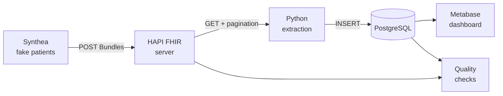
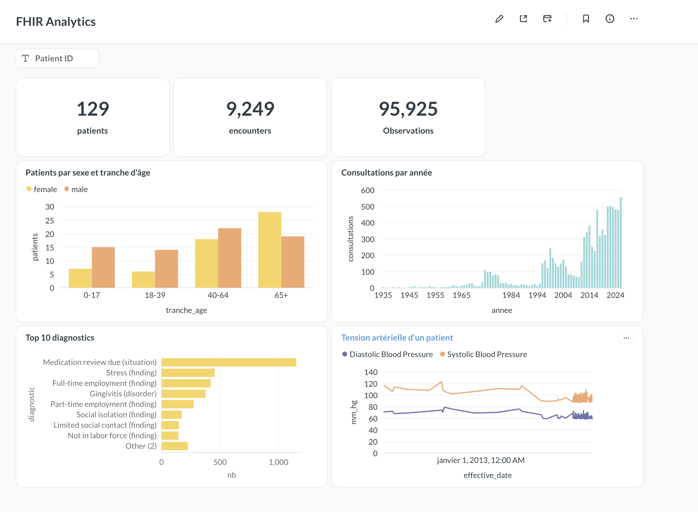

# FHIR to Analytics Pipeline
 
Project 1 of my Healthcare Interoperability Series.
 
## The problem
 
Hospitals and health software receive more and more patient data through **FHIR APIs**. FHIR is a standard made to **exchange** health data between systems, and it does this job well.
 
But the team that wants to analyse the data often has questions like these:
 
- How many patients do we follow, by age group?
- How many visits did we have each year?
- What are the most common diagnoses?
- How did this patient's blood pressure change over time?
A FHIR server can't answer them directly. It can return "all observations of patient 123", but it can't calculate an average or group results by year. And the data is deeply nested JSON, so it is hard to use for reporting.
 
There is a second problem. When data moves from one system to another, some of it can be **lost without any error**. The script runs, everything looks fine, but some values are missing. Nobody notices until a report shows wrong numbers.
 
## The solution
 
A small pipeline that:
 
1. reads the data from a FHIR server through its standard API,
2. converts it into simple SQL tables,
3. **checks that nothing was lost** and flags data quality problems,
4. shows the results in a dashboard.

 
All data is **synthetic** (generated by [Synthea](https://github.com/synthetichealth/synthea)). No real patient is involved.
 
## How it works
 
### 1. Generate and load patients
 
Synthea creates a full medical history for each fake patient: visits, diagnoses, lab results, vital signs. Each patient is a FHIR **Bundle** (a package of resources). A shell script sends each Bundle to the HAPI FHIR server.
 
### 2. Read the FHIR API
 
The Python script asks the server for each resource type (`Patient`, `Encounter`, `Observation`, `Condition`). The server answers page by page, so the script follows the `next` link until the last page.
 
### 3. Flatten the data
 
This is the main step. One FHIR resource becomes one row in a table.
 
```
FHIR Observation (JSON)                      SQL row (observations table)
-----------------------                      ----------------------------
"subject":   "Patient/1157"          ->      patient_id     = 1157
"encounter": "Encounter/1185"        ->      encounter_id   = 1185
"code":      LOINC 8302-2            ->      code           = 8302-2
             "Body Height"           ->      display        = Body Height
"valueQuantity": 124.5 cm            ->      value = 124.5, unit = cm
"effectiveDateTime": 2016-12-05      ->      effective_date = 2016-12-05
```
 
FHIR references (`Patient/1157`) become foreign keys (`patient_id`). This keeps the links between patients, visits and measurements.
 
```
patients  <----  encounters  <----  observations
    ^                ^
    +-------- conditions ---+
```
 
### 4. Check the result
 
After each load, a script compares the source and the target:
 
- **Completeness**: same number of resources in HAPI and in PostgreSQL?
- **Quality**: missing values, empty required fields, impossible dates, same code with different units.
If data is lost, the script stops with an error.
 
## Design decisions
 
| Decision | Why | Trade-off |
|---|---|---|
| Read the data from the FHIR API, not from the Synthea files | This is how it works in real life: you get data from a server. The script works with any FHIR R4 server, I only change the URL. | Slower than reading files directly. |
| One table per resource type, only the useful fields | Simple tables are easy to query. All other fields stay in HAPI. | Some information is not copied (extensions, metadata). |
| FHIR references become foreign keys | Keeps the links between patients, visits and measurements. PostgreSQL refuses an observation linked to a patient that doesn't exist. | Tables must be loaded in order: patients, encounters, then the rest. |
| IDs stored as `TEXT` | In FHIR, an ID is a string, even if HAPI uses numbers. | None in practice. |
| One row per `component` | Blood pressure has two values (systolic, diastolic). One row each makes them easy to query. A `fhir_id` column keeps the link to the original resource. | The table has more rows than there are FHIR resources. |
| A `value_text` column for coded values | Some answers are codes, not numbers ("Never smoker"). | Two value columns instead of one. |
| Full reload on each run, in one transaction | Simple, no duplicates. If something fails, the database stays as it was. | Not suited for large volumes. |
| Stop the extraction if HAPI is empty | Otherwise the reload would empty the tables and the dashboard. | None. |
| Analytics database separate from HAPI's database | HAPI manages its own storage. PostgreSQL is only for reporting, so the two can change independently. | Data exists in two places. |
 
## What the checks found
 
The checks were useful from the first run.
 
**1. 299 observations had no value.** My first mapping only read `valueQuantity` (a number with a unit). But FHIR stores values in different places:
 
| Measurement | Where the value is |
|---|---|
| Blood pressure | in `component`: one part for systolic, one for diastolic |
| Smoking status | in `valueCodeableConcept`: a coded answer, like "Never smoker" |
| Social questionnaire | in `component`: one part per question |
 
I updated the mapping. Result: **299 → 0** observations without a value.
 
**2. The same lab test was stored in two different units.**
 
- Kidney function (eGFR, LOINC `33914-3`): `mL/min` and `mL/min/1.73m2`
- Red blood cell width (RDW, LOINC `788-0`): `%` and `fL`
These values can't be compared or averaged together. The check flags them, so an analyst knows to filter on one unit.
 
## Dashboard
 



 
Examples of questions answered: patients by age and gender, visits per year, most common diagnoses, blood pressure over time for one patient. The SQL queries are in [`sql/queries.sql`](sql/queries.sql).
 
## Run it
 
Requirements: Docker, Java 17+, Python 3, make. Download `synthea-with-dependencies.jar` from the [Synthea releases](https://github.com/synthetichealth/synthea/releases) into `synthea/`.
 
```bash
cp .env.example .env      # then fill in the values
make venv                 # once
make up                   # start HAPI FHIR, PostgreSQL, Metabase
make run N=20             # generate 20 patients, load, extract, check
```
 
| Service | URL |
|---|---|
| HAPI FHIR (web UI) | http://localhost:8080 |
| FHIR API | http://localhost:8080/fhir |
| Metabase | http://localhost:3000 |
 
Run `make` to see all commands.
 
## Technical scope
 
**Covered**
 
- FHIR R4 (HAPI FHIR server)
- Resources: `Patient`, `Encounter`, `Observation`, `Condition`
- Writing to the server with `transaction` Bundles
- Reading with the REST API: search, `_count`, `_summary=count`, pagination with `next` links
- References between resources (`Patient/123`)
- Code systems: LOINC (measurements), SNOMED CT (diagnoses), UCUM (units)
- Observation value types: `valueQuantity`, `valueCodeableConcept`, `valueString`, `component`
- Completeness and data quality checks between the FHIR server and the database
**Not covered**
 
- Validation against FHIR profiles
- Authentication (SMART on FHIR, OAuth)
- Bulk Data export (`$export`)
- Incremental sync (only changed data)
- Other resource types (medications, immunizations, procedures)
## Tech stack
 
| Tool | Role |
|---|---|
| Synthea | generates realistic fake patients in FHIR R4 |
| HAPI FHIR | open source FHIR server (REST API, storage) |
| Python (requests, psycopg) | extraction and transformation |
| PostgreSQL | analytics database |
| Metabase | dashboard |
| Docker Compose, Make | run everything with a few commands |
 
## Limits
 
- Each run reloads everything. Fine for a few patients, not for millions.
- Synthea data follows US profiles (US Core).
- Runs locally only.
## Project structure
 
```
.
├── docker-compose.yml          HAPI FHIR, PostgreSQL, Metabase
├── Makefile                    all commands
├── scripts/
│   ├── load_to_hapi.sh         send Bundles to HAPI
│   ├── extract_fhir_to_postgres.py
│   └── check_quality.py        completeness and quality checks
└── sql/
    ├── schema.sql              tables
    └── queries.sql             dashboard queries
```